<p align="center">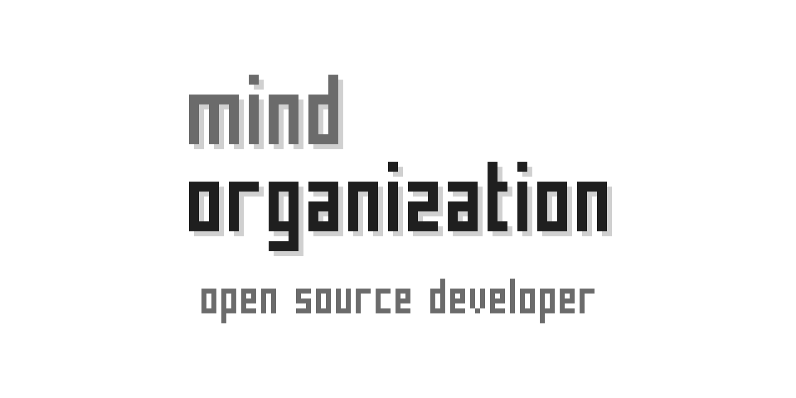</p>

# Mind Organization

### Stop starting from zero. Start from a system.

You have good ideas. What is missing is the order: where to start, what comes first, what the law asks, who to call back, what you decided last week. As long as a startup lives only in your head, it looks like a mountain. Mind Organization turns it into a path you can walk, one step at a time.

- **You have ideas but don't know where to start?** A few setup questions turn your project into a first plan: deadlines, decisions and the rules your agents follow.
- **Your startup feels like a mountain?** It becomes a list of next steps, each with a date and a source, and a Control Room that shows only what matters today.
- **You are missing the system and the automation?** AI agents research, draft and keep the records. Recurring jobs run on their own. You only decide.
- **You don't want to lose control?** Nothing is sent, paid or deleted without your yes. Every fact needs a source, and every decision is written down with its reason.

This is your chance to stop carrying everything in your head and start building, today.

---

Mind Organization is one Obsidian vault that runs a company and a personal life: decisions, deadlines, laws, money, daily routine. I built it for my own company, [Truffle Nose](https://trufflenose.ch), and use it every day. I have no formal training as a developer. Everything here was built by me, working with AI agents. If you download it, a short set of questions builds the same structure for your own project.

> **Grounded in NASA and NIST.** The rules for how the agents are built and governed draw on NASA's *Systems Engineering Handbook* and *Software Assurance and Software Safety Standard*, and on NIST's *AI Risk Management Framework*, *Generative AI Profile* and *Secure Software Development Framework*. Business answers come from the law (Fedlex, AADE) and from management and design books. [See all sources](#built-on-sources-not-on-memory).

This repository is a **showcase**. The demo vault uses invented data. My real vault (customers, contacts, prices, correspondence) is private and stays private.

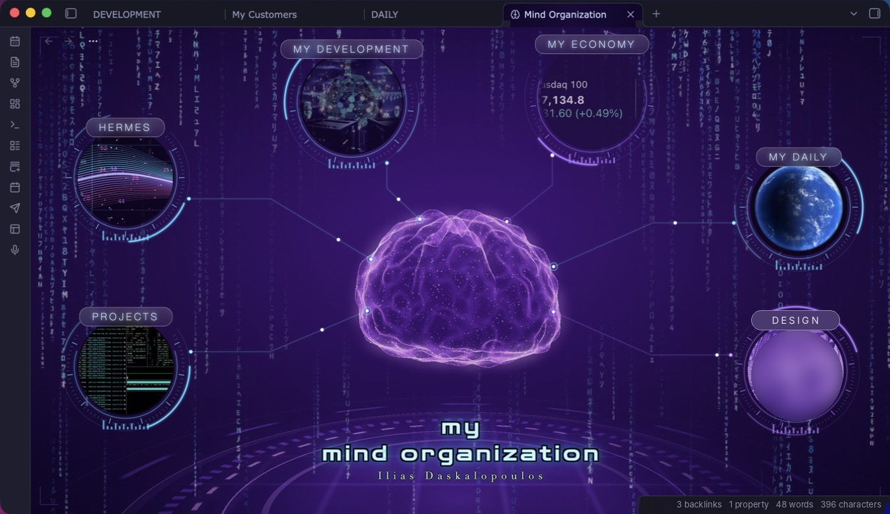

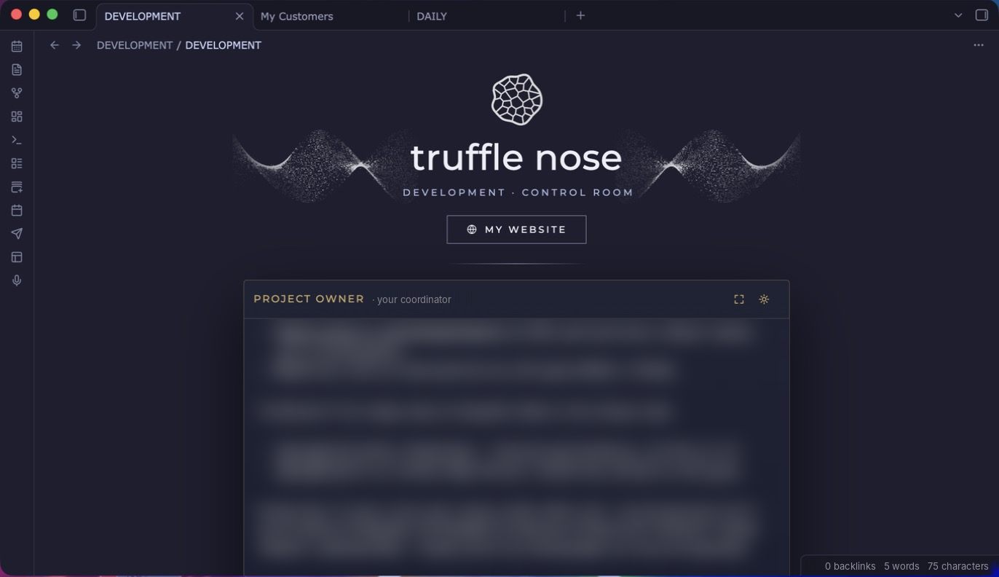

<sub>Screenshots marked *real* are from my actual vault. I work in Greek, so for this page the labels in the screenshots were translated into English. Chats, names, amounts and competitor logos are blurred.</sub>

---

## The idea

A small company needs the same things as a big one: decisions that are written down, deadlines that nobody forgets, answers that are followed up, research with sources. Instead of five apps, everything lives in **plain Markdown notes** in one vault. The vault is the single source of truth.

On top of the vault sit three things:

| Part | What it does |
|---|---|
| **The vault** | Memory of the company. Decision Log, Deadlines, Journal, Correspondence, Handbook (laws and sources), Competitors. |
| **Project Owner** (Claude, in chat) | Reads the vault at the start of every session, researches with sources, drafts emails and texts, keeps the records. |
| **Hermes** (local agent on my Mac) | Takes over recurring work: competitor price checks, website deployment, a monthly check whether a law page has changed. |

And one rule above all: **agents prepare, a human decides.** Nothing is sent, paid or deleted without my explicit approval. See [Rules](demo-vault/Rules.md).

## Everything is connected

Notes link to each other. A deadline points to the decision that created it, the decision points to the law or the book page behind it, the journal entry points to the email that started it. Open any note and you can walk to its reason in one or two clicks.

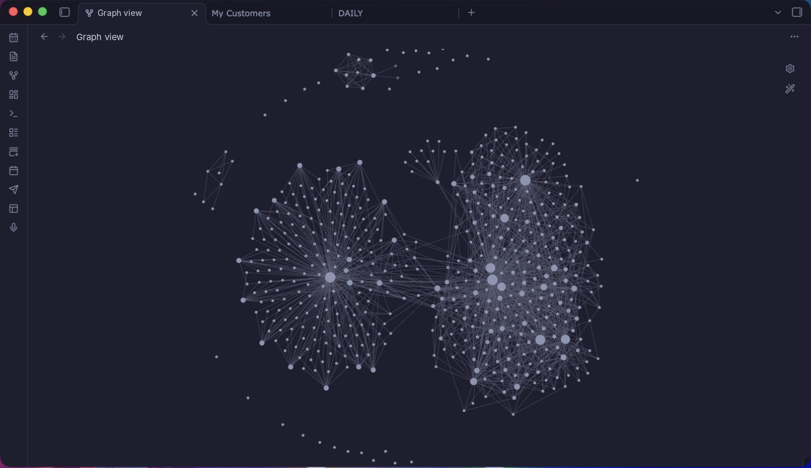

<sub>Real graph view. The left cluster is the knowledge base (book cards and sources), the right cluster is the company's records (decisions, deadlines, journal, correspondence). The links between them show which decision rests on which source.</sub>

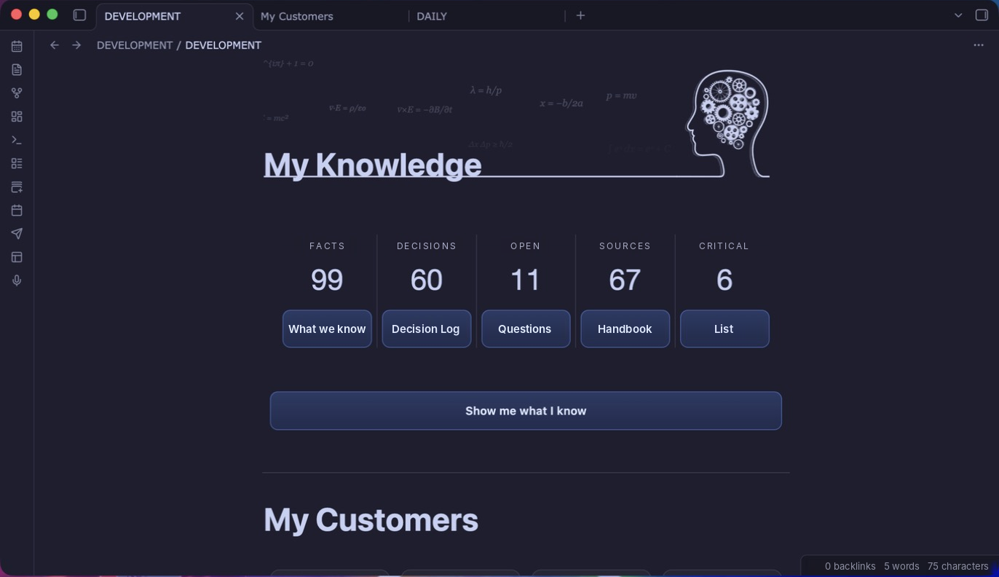

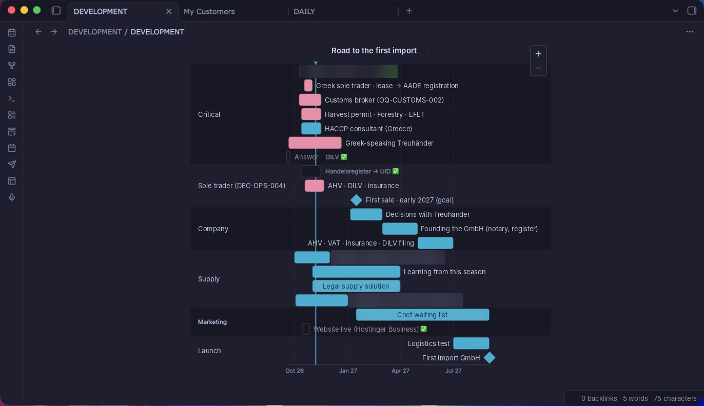


## Customers and competitors

**My Customers** is a small CRM inside the vault, built from one plain data file: lists by priority, live counters, filters by canton, category and status, and one card per business with its contact status and date.

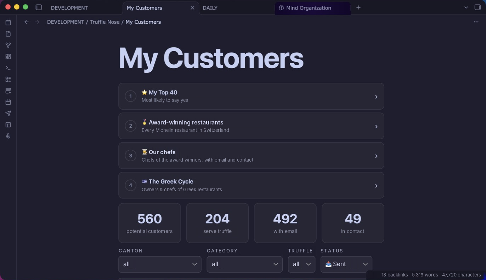

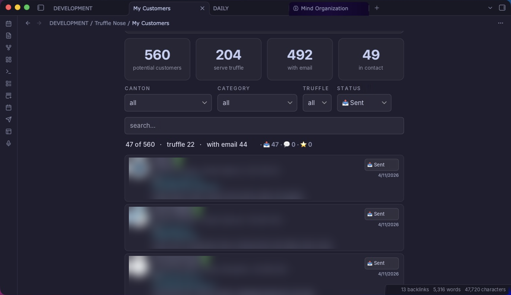

**My Competitors** keeps every competitor in one place: tiles by country, a price chart that updates with the filters, and a price table per truffle type. Hermes collects the public prices; the page calculates the rest.

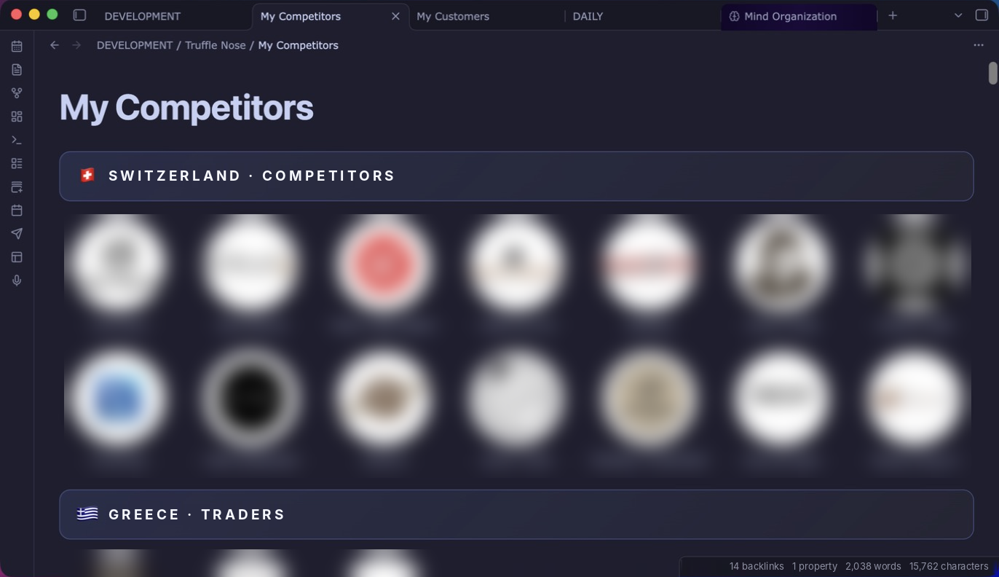

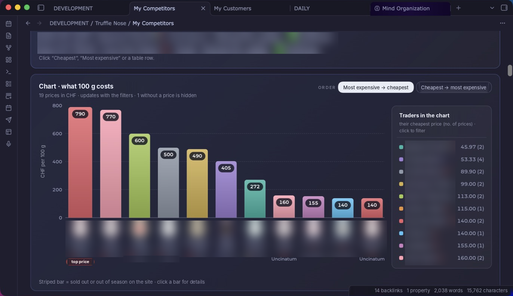

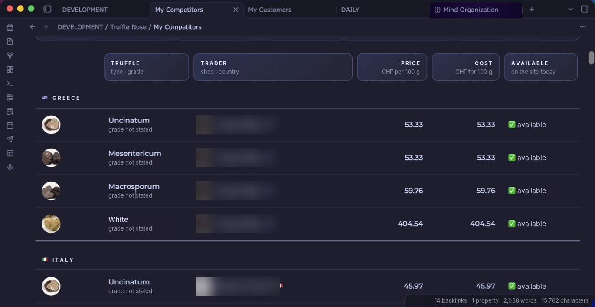

## The managers

Each manager is an agent with one job, its own written instructions and a fixed set of sources it may use. If something is not in its sources, it says so instead of guessing.

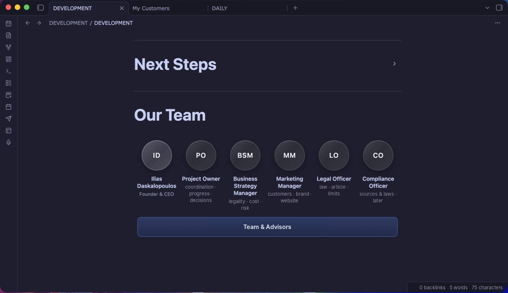

| Manager | Area | Works from |
|---|---|---|
| **Project Owner** | Runs the company day to day: records, emails, deadlines | Control Room, Decision Log, Deadlines, Journal |
| **Business Strategy Manager** | Law, cost, risk, numbers | The Handbook (laws and official sources) and the strategy books |
| **Marketing Manager** | Customers, brand, promises we make | Marketing and sales books, our own interviews |
| **Legal Officer** | Quotes the exact article of a law | Swiss law on Fedlex, Greek law and tax on AADE |
| **Source guardian** (on Hermes) | Once a month opens every official source and reports what changed | The Handbook |
| **Compliance Officer** (planned) | Sources and laws, later | The Handbook |
| **Price guardian** (on Hermes) | Collects public truffle market prices every week in season | Public market price lists |
| **Finance Manager** | My personal money (see My Economy below) | My own budget data |
| **Personal Assistant** | My day, routine, training and goals (see My Daily below) | My own plan and check-ins |

Every answer is marked: ✅ backed by a source, 🟡 estimate or our own reading, ❓ unknown, ⚠️ conflict. A strategy idea is checked against the Decision Log first, so the agents follow decisions already taken instead of reopening them.

## Built on sources, not on memory

**Laws and authorities.** Legal and tax answers come only from the Handbook: law texts and official pages from Fedlex (Swiss federal law), the cantons and AADE (Greek tax authority), each with the date it was checked. A searchable index lists more than 400 entries (laws, obligations, official sources, book cards).

**Management and business books.** The strategy and marketing skills read from these books, through reading notes and short cards with page numbers:

| Topic | Books |
|---|---|
| Marketing and brand | Kotler, Keller & Chernev, *Marketing Management* · Kapferer & Bastien, *The Luxury Strategy* · Miller, *Building a StoryBrand 2.0* |
| Pricing | Nagle, Müller & Gruyaert, *The Strategy and Tactics of Pricing* |
| Customers and sales | Fitzpatrick, *The Mom Test* · Rackham, *SPIN Selling* · Voss & Raz, *Never Split the Difference* · Guidara, *Unreasonable Hospitality* |
| Starting a company | OpenStax, *Entrepreneurship* |
| The truffle trade | Jacobs, *The Truffle Underground* · Purkayastha, *Truffle Boy* · Nowak, *Truffle: A Global History* |
| Research papers | Origin value of geographical indications, the truffle market, real truffle versus aroma, harvest and weather |

**Design.** The catalogue, the price pages and the website follow these books:

| Topic | Books |
|---|---|
| Page layout | Poulin, *Design School: Layout* |
| Grids | Tondreau, *Layout Essentials* |
| Website | Wathan & Schoger, *Refactoring UI* |
| Usability | Yablonski, *Laws of UX* |

**How the agents themselves are built.** *Agent Factory* is the engineering project in the vault that collects and verifies knowledge and, in later approved stages, will design, test and certify agents before they do real work. It works from a library of original publications, each stored unchanged with a SHA-256 fingerprint so every claim points to the exact file:

- **NASA**: *Systems Engineering Handbook* (NASA/SP-2016-6105 Rev 2), *Software Assurance and Software Safety Standard* (NASA-STD-8739.8B)
- **NIST**: *AI Risk Management Framework* (AI 100-1), *Generative AI Profile* (AI 600-1), *Secure Software Development Framework* (SP 800-218 and 800-218A), *Systems Security Engineering* (SP 800-160 Vol. 1), *Adversarial Machine Learning* (AI 100-2e2025)
- **Others**: OWASP *Top 10 for Agentic Applications 2026*, NSA *MCP Security Design Considerations*, the MCP Authorization Specification, Google SRE *Error Budget Policy*

From these come the governance rules: a role is not a permission, no evidence is not a pass, unknown stays unknown, and the one who builds something does not approve it.

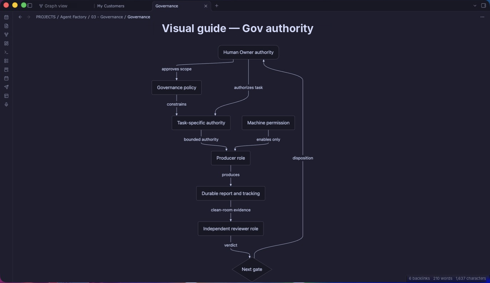

## Not only the company: My Daily and My Economy

The same vault keeps my personal life in order, with the same rule: agents prepare, I decide.

- **My Daily**: today's plan, weather, tasks and the week. The *Personal Assistant* keeps my routine, training log, goals and check-ins, and can reach me through a private Telegram bot.
- **My Economy**: income, expenses, savings, monthly reviews and plans. The *Finance Manager* works from plain data files (budget, transactions, accounts, obligations). The balance is always calculated, never typed by hand. Passwords and account numbers are never stored.

<p>
  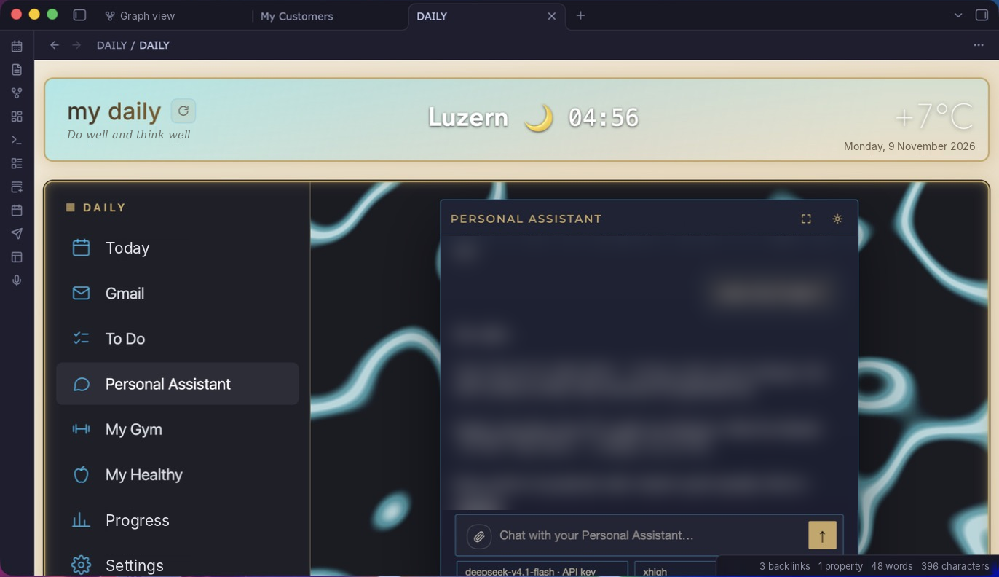
  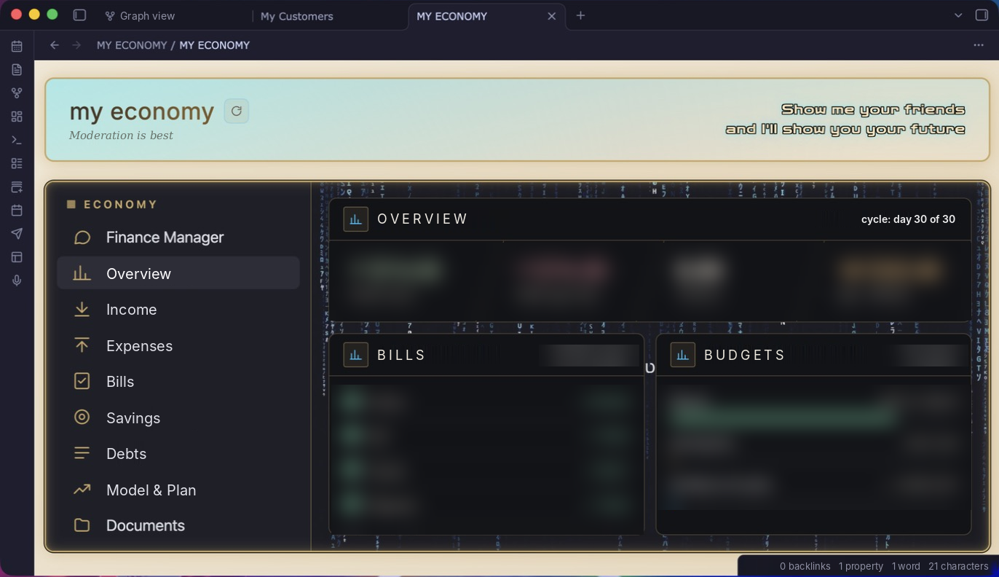
</p>

## Live blocks

The demo vault in this repository comes with a small open plugin, `mind-organization`, that turns plain notes into live views (the screenshot below is the demo, with invented data). Nothing on that page is typed by hand; it is calculated every time the page opens.

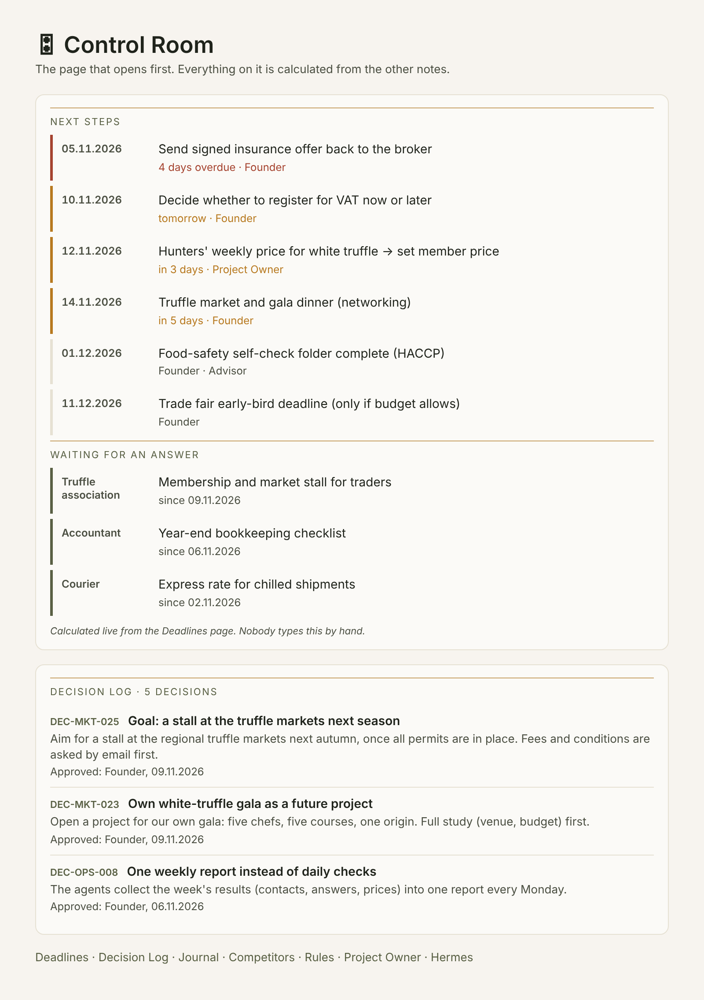

| Block | Reads | Shows |
|---|---|---|
| `mo-next` | `Deadlines.md` | Overdue, due this week, the next two, and who we are waiting for |
| `mo-deadlines` | `Deadlines.md` | Only what is overdue or due within seven days |
| `mo-decisions` | `Decision Log.md` | The latest decisions with ID, reason and who approved them |
| `mo-competitors` | the block itself | Competitor tiles grouped by country |

A deadline is just a table row:

```markdown
| When | What | Who |
|---|---|---|
| **10.11.2026** | Decide whether to register for VAT now or later | Founder |
```

A decision is just a heading:

```markdown
### DEC-OPS-006 · First sale only with all papers in order
- **Decision:** No sale before registration, food-safety self-check and insurance are complete.
- **Approved:** Founder, 01.10.2026
```

<p>
  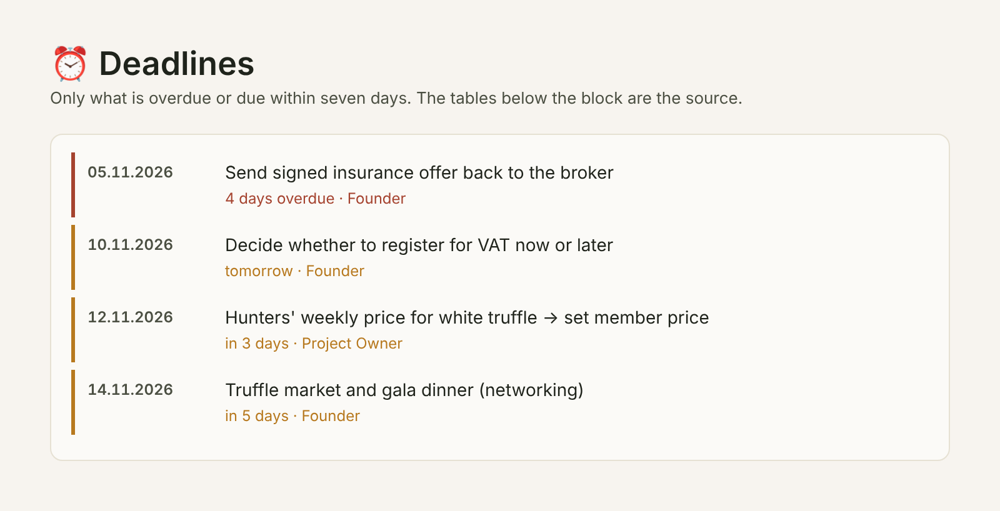
  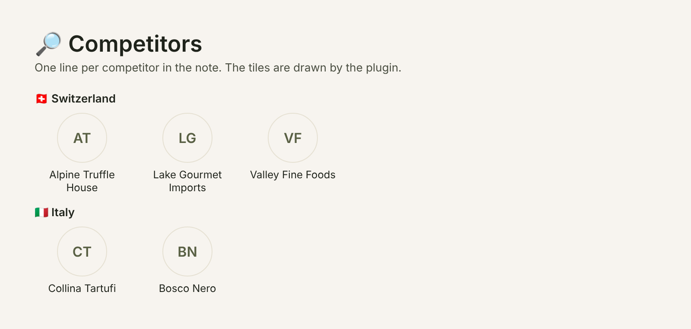
</p>

## How a day looks

1. I open Obsidian. The **Control Room** shows what is overdue, what is due this week and who has not answered yet.
2. I tell the Project Owner what I want, in a few words. It reads the Decision Log and Deadlines first, then researches, drafts and shows me the result.
3. Emails appear as a card (From / To / Subject). German emails get a word-for-word translation underneath. I approve, change or reject.
4. Every outcome is written back into the vault the same day: Journal, Correspondence, Deadlines, Decision Log.
5. Recurring jobs run on Hermes, not in the chat.

## Start your own vault: the setup questions

You do not have to copy my vault. When you open it for the first time, Mind Organization asks you a few questions and builds a vault for **your** project. It works in two rounds.

**Round 1, in Obsidian, no AI needed.** A short window asks who you are, which country you work in (laws and taxes are checked for that country), and what you want to organize:

| You choose | You get |
|---|---|
| Small company / startup | Control Room, Decision Log, Deadlines, company page, Customers, Competitors, Business Strategy Manager, Marketing Manager |
| Freelancer / self-employed | Clients, Offers, deadlines for offers and invoices |
| Personal life | My Daily with Personal Assistant, My Economy with Finance Manager |
| Studies, research or a creative project | Topic page, sources, reading-note template, Research Assistant |

Then a few questions about the chosen projects (what you sell, where you are today, your one goal for the next six months, your main sources) and the rules every agent follows. Your answers become real notes: the first deadlines, the first decisions, the rules and the agents' instructions. Nothing leaves your computer, and existing notes are never overwritten.

<p>
  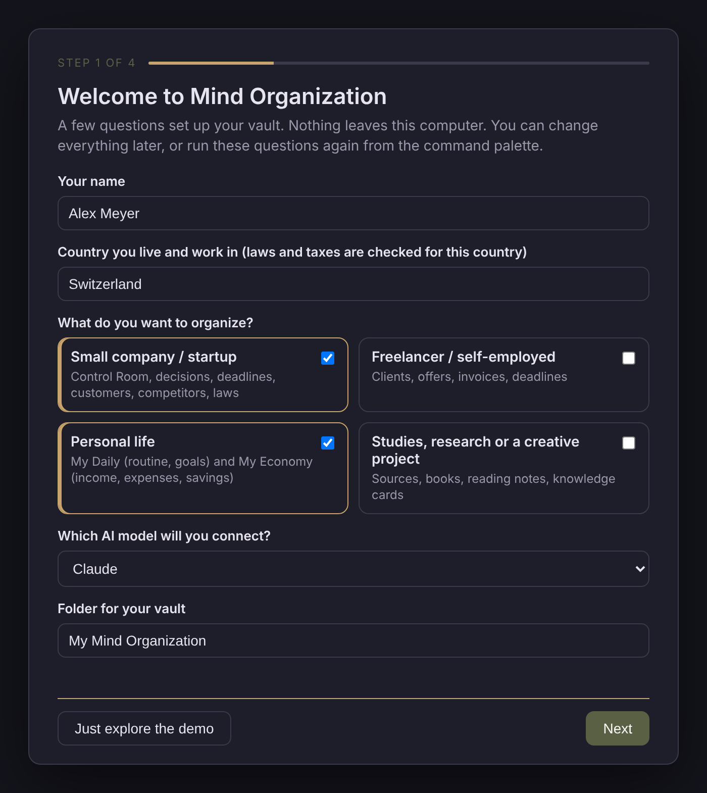
  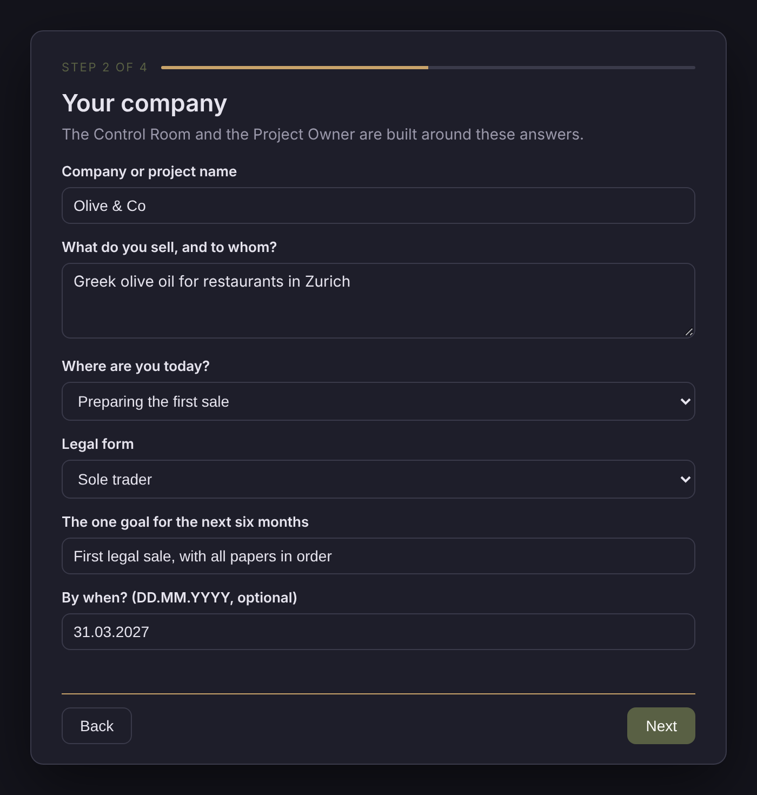
</p>

**Round 2, when you connect an AI model.** The setup also writes `Setup/AI Interview.md`. Give it to your model (Claude, DeepSeek, Gemini, Grok or a local model). The model then interviews you, one question at a time, about everything it took me months to work out for my own company: legal form and registration, the authorities and laws for your product, VAT, insurance, suppliers, customers, competitors, price, and what must be true before the first sale. For personal life it asks about your day, routines, budget and savings goals; for studies about your question, allowed sources and dates. It writes nothing without your yes, and every fact needs a source. The full list of questions is in [docs/SETUP.md](docs/SETUP.md).

> **Built on Anthropic's Claude.** In my own vault the Project Owner and the managers run on Claude, Anthropic's AI model. Each manager is written as a Claude skill with its own instructions and sources, and the AI interview was written with Claude. It also works with other models. Mind Organization is an independent project and is not affiliated with or endorsed by Anthropic.

You can run the questions again at any time: command palette → **Mind Organization: Run the setup questions**.

## The demo looks like the real thing

The demo vault is not an empty template. It has the same design as my own vault, filled with invented companies, prices and numbers, so you see how it works before you put in your own:

- **Start page:** the brain in the middle, drawn live in WebGL, and six circles that open Hermes, Projects, My Development, My Economy, My Daily and Design.
- **Control Room:** a header with particle waves, the goal with a live countdown, next steps, the Decision Log, My Knowledge with its counters, customers and competitors whose logos scroll past, the road map and the team.
- **My Customers:** lists, counters, filters and one card per customer, all drawn from one table.
- **My Competitors:** logos by country, a price chart and a price table.
- **My Daily** with the Personal Assistant, and **My Economy** with the Finance Manager.

Change a table in a note, and the page changes with it. The logos of the invented companies are drawn by the plugin, so nothing is downloaded.

**Optional: live market ticker.** In the setup questions you can turn on a live ticker (S&P 500, Nasdaq, Bitcoin, gold) inside the My Economy circle of the start page. It is off by default, because it loads a free widget from [TradingView](https://www.tradingview.com) and needs internet. Turn it on or off later with **Mind Organization: Turn the live market ticker on or off**.

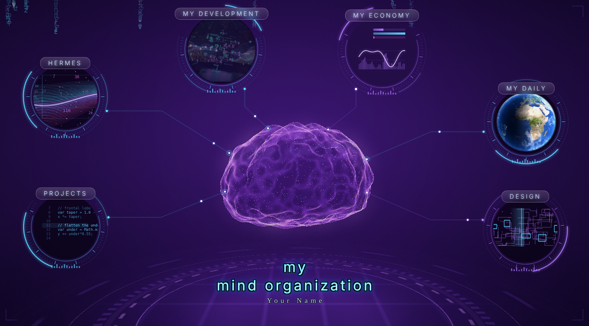

<p>
  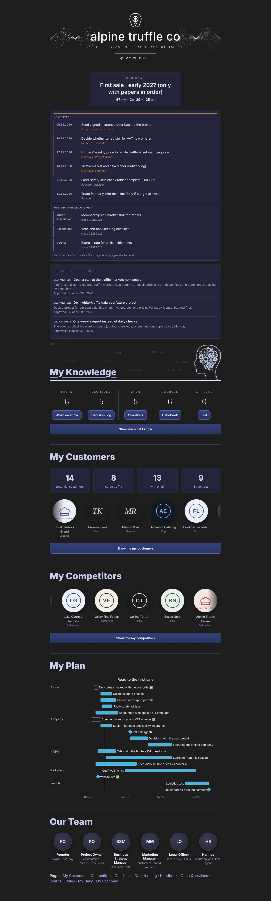
  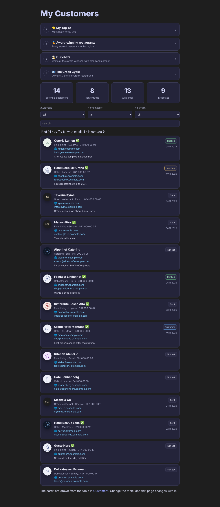
</p>
<p>
  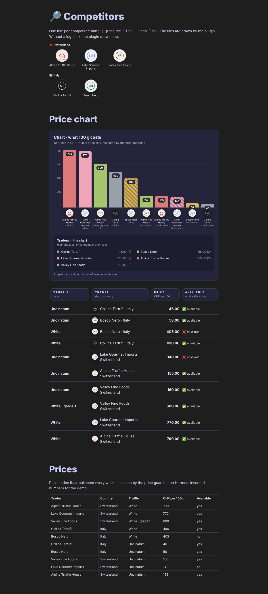
  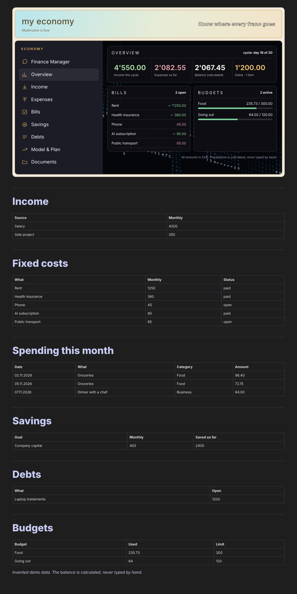
</p>

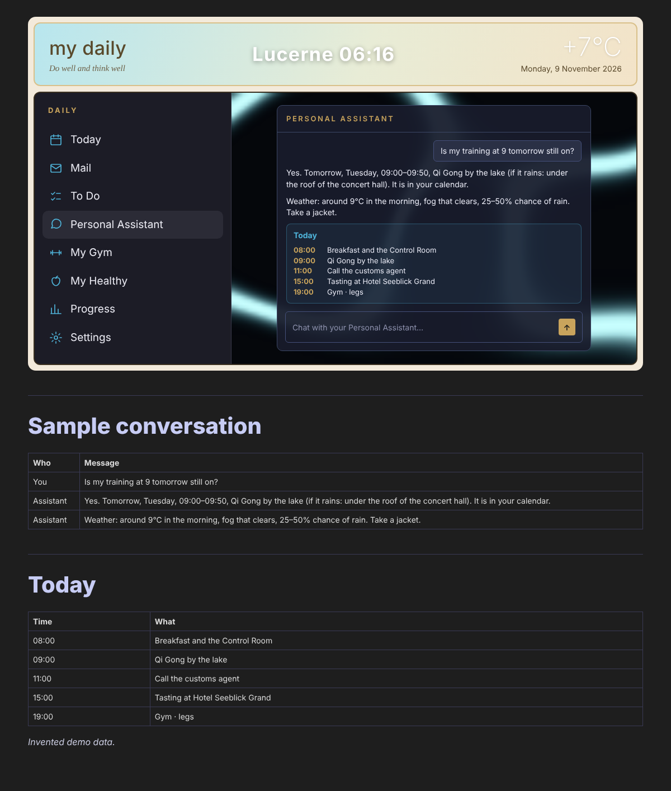

## Try the demo

1. Download this repository and open the `demo-vault` folder as a vault in [Obsidian](https://obsidian.md).
2. Settings → Community plugins → turn on **Mind Organization**.
3. The start page and the setup questions open. Answer the questions to build your own vault next to the demo, or choose **Just explore the demo**.
4. Click a circle on the start page, or open `Control Room.md`.

The plugin needs no account and works offline. It only reads and writes notes in your vault. The start page loads its display fonts from Google Fonts when you are online, and falls back to system fonts when you are not. The optional market ticker is the only other part that goes online.

## Repository

```
demo-vault/          Example vault with invented data (open this in Obsidian)
plugin/              Plugin source: render.js, setup.js and showcase.js (pure DOM), plugin.js (Obsidian), styles.css
  assets/            Start page (landing.html), its two videos, the header waves and the My Knowledge drawing
  build.sh           Builds main.js and copies it into the demo vault
preview/             screenshots.js, setup-shots.js and showcase-shots.js render the README images
docs/SETUP.md        Every setup question, both rounds
docs/screenshots/    Images used in this README
```

The render and setup code is plain DOM without any Obsidian dependency, so the same functions draw the blocks and the setup questions inside Obsidian and in the screenshots.

## What is not here

The real vault's content stays private: customer lists, correspondence, prices, the law texts and book notes, My Daily and My Economy data. Screenshots of the real vault show the layout only; names, amounts, emails and other personal details are blurred. The books and standards above are listed as references; their content is not copied here.

## About

**Ilias Daskalopoulos** · Developer of Mind Organization · Luzern  
Founder of [Truffle Nose](https://trufflenose.ch)

License: MIT
